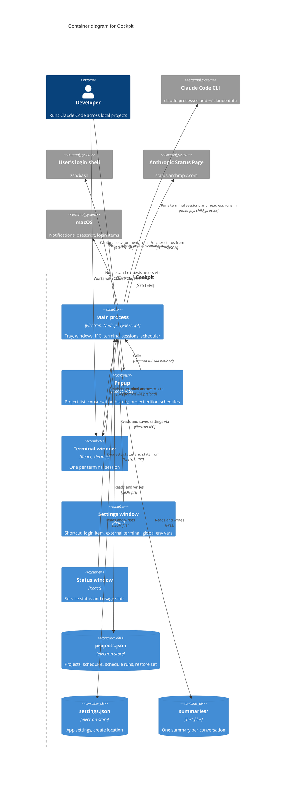

# Containers: Cockpit

Cockpit is one Electron app. Its containers are the processes it runs and the files it
keeps, all on the user's Mac. Claude Code processes are started by Cockpit but are Claude
Code, so they appear as one external system.

- **Main process** (`src/main/`): owns all state and every side effect. It spawns `claude`
  directly in a PTY for each terminal session, runs headless schedule runs as plain child
  processes, and runs the scheduler (node-cron) in-process, so schedules fire only while
  Cockpit is running.
- **Renderer windows** (`src/renderer/`): four Vite entry points (`index.html` for the popup,
  `terminal.html`, `settings.html`, `status.html`). They have no Node access
  (`contextIsolation`, no `nodeIntegration`) and reach the main process only through the
  `window.cockpit` and `window.terminal` APIs in `src/preload.ts`.
- **projects.json** and **settings.json**: electron-store files in
  `~/Library/Application Support/cockpit/`. Terminal sessions live only in memory, and so does
  the queue of waiting schedule runs (their records are saved as "queued").
- **summaries/**: `<userData>/summaries/<encoded project path>/<conversation id>.summary`,
  kept in Cockpit's app data rather than Claude Code's, so the cask's `zap` removes them. Conversations themselves stay in
  Claude Code's own folder; Cockpit only reads them, or deletes one when the user asks.
