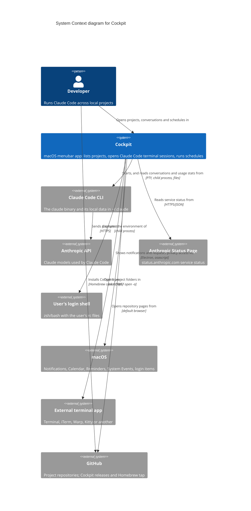

# System Context: Cockpit

Cockpit runs on one Mac, for one user. Everything it does happens on that machine except
two outbound calls: the Anthropic status page, and the Claude model calls that Claude Code
makes on its behalf (summaries, schedule interpretation, and the user's own work).

- **Claude Code CLI** is the core dependency. Cockpit finds the `claude` binary
  (`src/main/claude.ts`), runs it in terminal sessions and headless schedule runs, and reads
  Claude Code's conversation files (`~/.claude/projects/`) and usage stats
  (`~/.claude/stats-cache.json`). It also uses it to generate summaries and to interpret
  natural-language schedules, both with the Haiku model.
- **Anthropic API** is reached only through Claude Code. When a terminal session ends,
  Cockpit sends the first and last 20 KB of that conversation's file to Claude Code to
  generate a summary, so part of every conversation goes to the model a second time.
- **Anthropic Status Page**: `GET https://status.anthropic.com/api/v2/status.json` for the
  status window. It is the only network call Cockpit makes itself.
- **User's login shell** is run as `$SHELL -ilc` before every Claude Code process starts, so
  the process gets the same environment as a new terminal tab.
- **macOS**: bell notifications, launch at login, and `osascript` prompts for Calendar,
  Reminders and Automation access (macOS privacy access).
- **External terminal app**: Cmd+T opens the project's folder in the user's chosen app.
- **GitHub**: project pages open in the browser. Cockpit itself is distributed from GitHub
  Releases and the `mcoquet/homebrew-cockpit` tap.
