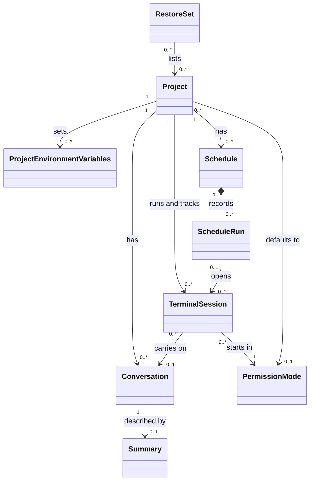

# Domain Model

How Cockpit's concepts relate: projects, the terminal sessions and conversations of
Claude Code work in them, and the schedules that start that work on a timer. Terms are
defined in [`GLOSSARY.md`](../GLOSSARY.md).

## Concepts and relationships

Diagram names are the glossary terms without spaces.

- A **Project** runs zero or more **Terminal sessions** at once, each in its own window.
- A **Project** tracks every one of its running **Terminal sessions**, however many
  windows it has open. It is an **Active project** while at least one runs.
- A **Project** has zero or more **Conversations**, recorded by Claude Code, not by Cockpit.
- A **Terminal session** carries on at most one **Conversation**: a new one, the most recent
  one (continue), or a chosen one from the conversation history (resume).
- A **Conversation** is described by at most one **Summary**.
- A **Terminal session** starts in exactly one **Permission mode**; a **Project** defaults to
  at most one (no default means Claude Code's own default).
- A **Project** sets zero or more **Project environment variables**.
- A **Project** has zero or more **Schedules**.
- A **Schedule** records zero or more **Schedule runs**, which don't exist without it.
- An interactive **Schedule run** opens one **Terminal session**; a headless one opens none.
- The **Restore set** lists the projects that had terminal sessions running when Cockpit
  last quit or restarted for an upgrade. There is one restore set, possibly empty.

## Invariants

- No two projects have the same location.
- A project's location never changes after it is added.
- Every Claude Code process started for a project (terminal sessions and headless schedule
  runs) gets the global environment variables overlaid with that project's environment
  variables, the project's value winning. Summary generation and schedule interpretation
  get the global environment variables only.
- An environment variable name is letters, digits and underscores, not starting with a
  digit; rows with any other name are dropped when saved.
- A terminal session opened from a project click always starts a new conversation; one
  opened from the conversation history resumes the chosen conversation. Reopening the
  restore set continues each project's most recent conversation.
- If a terminal session that was told to continue the most recent conversation exits with
  an error (code 1) within three seconds, Cockpit replaces it with one that starts a new
  conversation.
- A terminal session starts in the permission mode chosen for that launch (Option+click on
  a project), otherwise in its project's default permission mode, otherwise in Claude
  Code's default. This holds however it is opened: project click, conversation history,
  Cmd+N, reopening the restore set, creating a project, an interactive schedule run, or
  the replacement after a failed continue (which keeps the mode of the one it replaces).
  A headless schedule run starts in its project's default permission mode.
- A conversation's summary is written once and never regenerated; deleting a conversation
  deletes its summary.
- A schedule fires only while it is enabled and Cockpit is running.
- Deleting a schedule deletes all its schedule runs.
- At most 1,000 schedule runs are kept across all schedules; the oldest are dropped first.
- When a schedule with queue behaviour **skip** comes due while its previous run is still
  going, the new schedule run is recorded as failed ("Skipped") and does not run.
- Cockpit does not quit while any terminal session is running unless the user confirms;
  the confirmation counts terminal sessions, not projects. Confirming saves the restore set. An upgrade restart does not ask, but saves the
  restore set first.
- The restore set lists each project at most once, even if it had several terminal
  sessions running; reopening it opens one terminal session per project.
- The restore set is cleared once it has been reopened.
- Window → "Open in External Terminal" (Cmd+T) and Cmd+N act on the project of the
  terminal window last used, whichever of a project's windows that is.

### Current behaviour worth knowing

These follow from the code as built; they are gaps, not rules.

- Removing a project does not remove its schedules: they stay enabled and keep firing.
- **Catch-up** is stored on a schedule but nothing acts on it; missed occurrences are never
  run.
- Queued schedule runs wait only in memory. If Cockpit quits first, they stay "queued" in
  the record and never run.

## Lifecycles

**Terminal session**: Starting → Running → Ended (Claude Code exited or the window was
closed; either one ends the other).

**Schedule**: Enabled ⇄ Paused → Deleted.

**Schedule run**: Queued → Running → (Success | Failed). Under **skip**, a run that comes
due during a previous one goes straight to Failed. Under **parallel** it starts Running at
once.
